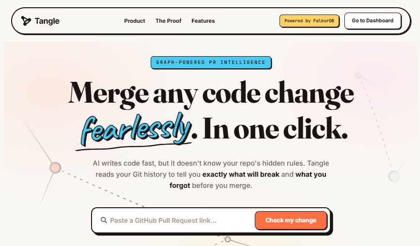
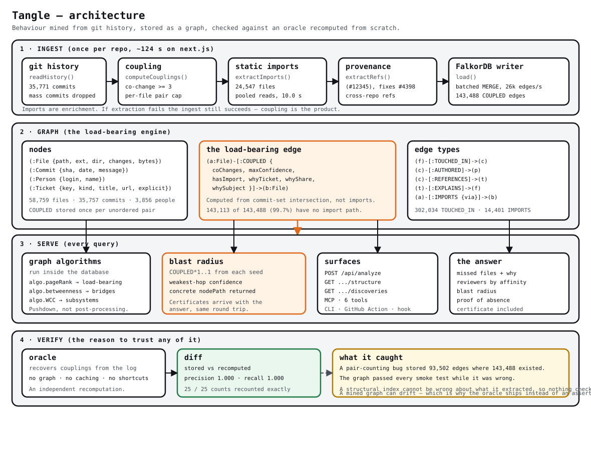

<div align="center">
  

  <h1>Tangle</h1>

  <p><b>The Graph Guardian for your Codebase</b></p>
  <p>Vector RAG can't tell you when it doesn't know.<br />Tangle tells you what your change breaks, what you forgot, and exactly how much of the graph it searched to say so.<br /><sub>Absence is bounded, not proven. The certificate states the bounds.</sub></p>

  <p>
    <a href="https://falkordb.com"></a>
    <a href="https://www.typescriptlang.org/"></a>
    <a href="https://modelcontextprotocol.io/"></a>
  </p>
</div>



<br/>

## The agent loop

This is the part that matters, and it is the part a screenshot of a dashboard does not show.

```text
  agent edits a file
        |
        v
  Claude Code PostToolUse fires
        |
        v
  tangle hook check  ──▶  graph traversal from the changed files
        |
        |   nothing strongly coupled  ──▶  stays SILENT (never nags)
        |
        |   3 files coupled and missing
        v
  agent sees: "3 file(s) are usually included with these changes"
     - packages/font/src/google/font-data.json   changed together 82x
       why: vercel/next.js#40221, "Add support for font loaders"
        |
        v
  agent adds them, or explains why it is not adding them

  Repeat. The graph shapes what the agent does, on every edit.
```

```bash
npx tangle install --write --hook    # one command, seven agents wired
```

The hook stays silent when there is nothing to say. A check that speaks up on every edit
trains people to disable it, which is the usual way an agent check dies.

---

## ⚡ Quickstart

Three commands, from nothing to a working check.

```bash
git clone https://github.com/tangle-dev/tangle && cd tangle
npm install
docker compose up -d                       # FalkorDB on :6379
npm run ingest -- --repo vercel/next.js   # ~90s, couplings only
```

Then ask it about any change:

```bash
npm run check -- --repo vercel/next.js --files packages/next/server/image-optimizer.ts
```

```text
Tangle · vercel/next.js

**9 file(s) strongly coupled to this change are not in it — very likely incomplete.**

Most likely forgotten:
- `test/integration/image-optimizer/test/index.test.js` — changed together 20×, and Fix Image Optimization cache-control regression with external images (#19914)
- … and 8 more.

_Bounded claim: confidence ≥ 0.3, 2 hop(s), 133 of 143,488 coupling edges inspected.
Absence of a coupling here is not proof of independence._
```

That last line is not decoration. It is on **every** verdict, including the clean ones, because "nothing found" and "nothing found within these limits" are different claims and only the second one is true.

### Wire it into your agent

```bash
npx tangle install                  # prints the config for every supported agent
npx tangle install --write          # applies it, backing up anything it changes
npx tangle install --write --hook   # …and runs the check after every edit
```

Claude Code, Claude Desktop, Cursor, VS Code, Windsurf, Codex CLI and Gemini CLI, in one command. `install` writes nothing without `--write`, is idempotent, preserves other MCP servers and any settings you have, and **refuses rather than overwrites** if a config file is not valid JSON.

<details>
<summary>Or wire it up by hand</summary>

```json
{
  "mcpServers": {
    "tangle": { "command": "npx", "args": ["--yes", "tangle-mcp", "--mcp"] }
  }
}
```

Claude Code and Cursor use `mcpServers`, VS Code uses `servers`, Codex uses TOML.

</details>

### Comment on pull requests

```yaml
# .github/workflows/tangle.yml
name: Tangle
on: pull_request
jobs:
  check:
    runs-on: ubuntu-latest
    steps:
      - uses: actions/checkout@v4
      - uses: tangle-dev/tangle@v1
        with:
          tangle-version: v1
```

That comment is the form people actually share:

```markdown
### 🚨 Tangle — 3 coupled file(s) not in this PR

9 file(s) strongly coupled to this change are not in it — very likely incomplete.

| File | Why it is coupled |
| --- | --- |
| `test/integration/image-optimizer/test/index.test.js` | changed together 20×, and Fix Image Optimization cache-control regression with external images (#19914) |
```

One comment per PR, updated in place. The action does **not** fail your build by default — a bot that fails CI on a warning is a bot whose warnings get muted. Opt in with `fail-on: true`.

<details>
<summary>What the action does, and what it refuses to hide</summary>

- Starts FalkorDB and waits for the port, rather than sleeping a fixed amount.
- Caches the history clone, so a cache hit turns a multi-minute ingest into seconds.
- Ingests couplings-only by default, which is what a PR check needs.
- Posts a comment saying **"no verdict is available, and no verdict should be inferred from the absence of one"** if it cannot run. Silence that reads as approval is the one outcome a reviewer must never mistake for a passing signal.

</details>

<br/>

## ⚡ What is Tangle?

If you've built an AI coding agent recently, you've probably hit the wall of vector search. When an engineer asks, *"What will breaking this file affect?"*, an LLM with semantic search usually retrieves the top 10 most similar files and hallucinates a connection.

> **A vector index can't tell you what it ruled out.** Tangle can: every answer ships with the threshold, the hop budget, and the share of the graph actually inspected. That is a bounded claim, not a proof, and the output says so.

**Tangle** solves this by mining your Git commit history and AST imports into a **FalkorDB** graph. By leveraging the power of graph algorithms, Tangle finds **Phantom Couplings** — files that *always* change together, but have zero explicit connection in the code.

When you submit a PR, Tangle tells you:

1. 💥 **The Blast Radius:** Transitively coupled files affected by your change.
2. 👻 **What You Forgot:** Files strongly coupled to your change that were omitted from the diff.
3. 🕵️ **Why:** The pull request or issue behind each coupling, and how much of it that change accounts for.
4. 👤 **Who Should Review It:** Ranked by the share of the *affected files'* history they own.
5. 🛡️ **Proof of Absence:** A certificate proving exactly how much of the graph was traversed, what was ruled out, and why.

### Two things structural indexes do not have

Graph tools in this space index structure: imports, symbols, call edges. That
answers *what is wired to what*. Tangle mines **behaviour** - what actually moved
together across 35,771 commits - and adds two capabilities on top of that:

| | Structural indexes | Tangle |
| --- | --- | --- |
| **Why is A coupled to B?** | Cannot say. No ticket, no PR, no author. | 64.4% of forgotten files in the `next.js` back-test had a PR or issue naming the coupling. |
| **How do I know the graph is not lying?** | No oracle - a structural graph is right by construction, so nothing checks it. | `npm run verify` recomputes couplings from the commit log with no graph and no caching, then diffs: precision 1.000, recall 1.000, 25/25 stored counts recounted exactly. |

The second row matters most. A structural graph cannot be *wrong* about what it
extracted. A mined graph can be silently wrong - a mass-refactor commit, a bot
commit, an off-by-one in the pair counter that shipped in this repository and was
caught exactly this way - which is why it needs an oracle, and why Tangle ships one
that recomputes from scratch rather than one that asserts.

On the couplings the import graph **cannot** reach at all - 143,113 of 143,488 on
`next.js` - Tangle holds 1.6% precision at 6.4% recall, where a structural index
scores a structural zero by definition.

---

## 🕵️ The "Why"

Change coupling says *that* two files always move together. It never says *why* — and the reason is usually written down somewhere.

Tangle recovers it from the git log. `(#12345)` from a squash merge, `Merge pull request #123`, `Fixes #4398` in a commit body, `vercel/turbo#3835` across repos. No API call, no LLM, no guessing.

```bash
npm run why -- --repo vercel/next.js --limit 8
npm run why -- --repo vercel/next.js --couplings --limit 10
npm run why -- --repo vercel/next.js src/a.ts src/b.ts
```

```text
  issue vercel/next.js#62321  74 file(s) · 5,182 effective mention(s)
    Revert "Migrate Sass tests to test/e2e"
    https://github.com/vercel/next.js/issues/62321
    1 of 2 citing commit(s) were reverts
    spans test/e2e/app-dir
       9×  test/e2e/app-dir/scss/invalid-global-with-app/…test.ts <-> test/e2e/app-dir/scss/invalid-global/…test.ts
       6×  test/e2e/app-dir/scss/invalid-global-with-app/…test.ts <-> test/e2e/app-dir/scss/invalid-module-document/…test.ts
```

That is the claim that separates this from a co-change graph: **not** "these two files always move together" but "they move together because of this issue, and here it is."

Three details that took measurement to get right:

1. **Reverts are excluded from attribution, and the discount is shown.** The first version ranked `Revert "Revert …"` tickets at the top — one accounting for 8,632 mentions across 62 files. The counts were accurate; the inference was nonsense, because a revert and its re-revert cite a ticket twice while *undoing* the work. Reverts still write their `REFERENCES` edges because the history is real.
2. **Explicit links are separated from mentions.** `Fixes #4398` is someone stating a causal claim. `(#4398)` is a squash-merge convention. Both are recorded; only the first is called explicit.
3. **A coupling with no ticket is reported as having no ticket.** On `next.js`, 99.2% of couplings get an attribution and 26 of 35,757 commits carry an explicit `fixes`/`closes`. That is a *strong* result for a squash-merging repository, and the back-test reports the same figure from the other direction so both numbers can be checked against each other.

`npm run verify` cross-checks the denormalised copy on each `COUPLED` edge against the `EXPLAINS` edge that is its authority.

---

## 🚀 Quick Start

### 1. Requirements

- Node.js 20+
- Docker (for FalkorDB)

### 2. Start FalkorDB

Launch the FalkorDB graph database in the background:

```bash
docker compose up -d
```

### 3. Ingest a Repository

```bash
npm install
npm run ingest -- --repo vercel/next.js --fresh
```

> *(Note: Ingesting a massive repo like `vercel/next.js` takes ~6 minutes to build the AST import graph and temporal coupling matrix from Git history.)*

### 4. Run the Web UI

```bash
npm run serve
```

Go to **[http://localhost:8787](http://localhost:8787)** to use the sleek SaaS interface.

---

## 🔌 Agent & MCP Integration

Tangle is designed to be a drop-in tool for Autonomous AI Agents. It includes a standard **Model Context Protocol (MCP)** server so any LLM (Claude, Cursor, etc.) can query the graph before writing code.

```bash
npm run install -- --write   # or: npx tangle install --write
```

**One primary tool.** An agent choosing between twenty options does not choose well, and a 200-line JSON blob is worse than a paragraph it can act on. `tangle_check` returns a short verdict; the rest exist to be called *after* it says there is something to look at.

| Tool | When an agent should call it |
| --- | --- |
| **`tangle_check`** | **Always, before finishing a change.** Returns a verdict: `clean`, `caution`, or `blocked`. |
| `tangle_analyze` | The full picture — blast radius, commit evidence, reviewer routing, certificate. |
| `tangle_why` | "Why are these two files coupled?" — the PR or issue behind it. |
| `tangle_tickets` | Which decisions quietly hold this codebase together. |
| `tangle_discoveries` | Phantom couplings across the whole repository. |

### The verdict

```text
**9 file(s) strongly coupled to this change are not in it — very likely incomplete.**

Most likely forgotten:
- `test.js` — changed together 30×, and Add `lowercase` option (#11)
- `readme.md` — changed together 20×, and Add `lowercase` option (#11)
- … and 6 more.

_Bounded claim: confidence ≥ 0.3, 2 hop(s), 24 of 24 coupling edges inspected.
Absence of a coupling here is not proof of independence._
```

Three properties, each of which cost something to get right:

1. **The caveat is unconditional.** Every verdict states its own bounds. A clean verdict with no caveat is the one output that cannot be trusted.
2. **Severity is a ratio, not a count.** Three missed files in a two-file change means the change is misunderstood; the same three in a forty-file change is unremarkable.
3. **"Clean" never means "correct".** The back-test measured 576 cases where the warning list came back empty; in none of them was a forgotten file coupled to the diff and dropped. It was 456 of 1,032 before the confidence gate was removed. The clean verdict still says *"nothing strongly coupled is missing"*, not *"your change is complete"*, because 1,755 held-out files had no co-change partner at all.

### The self-correction hook

```bash
npx tangle install --write --hook
```

Claude Code runs `PostToolUse` after any file-writing tool, so the check fires when the agent has just finished editing. It stays **silent** when there is nothing to say — a hook that speaks up on every edit trains people to disable it — and asks git for the origin remote, so one global install works across every project.

---

## 🧠 How It Works: The Graph Model



<details>
<summary>Text version, for reading in a terminal or in a diff</summary>

```text
  +-- 1. INGEST --- once per repo, ~124s on next.js ---------------------+
  |                                                                     |
  |   git history ---> coupling --+                                    |
  |    35,771 commits    co-change |                                   |
  |                        count  |                                   |
  |   static imports ---> regex ----+---> load() ---> FalkorDB writer   |
  |    24,547 files       scan        |       batched   26k edges/s  |
  |    pooled, 10.0s      10.0s       |                              |
  |                                 |       143,488 COUPLED edges    |
  |   commit messages --> refs       |                              |
  |    (#12345)                     |                              |
  +---------------------------------+------------------------------+
                                    |
                                    v
  +-- 2. GRAPH --- the load-bearing engine --------------------------+
  |                                                                     |
  |    (:File)   (:Commit)   (:Person)   (:Ticket)                  |
  |                                                                     |
  |    (a)-[:COUPLED {coChanges, maxConfidence, hasImport,           |
  |                   whyTicket, whyShare, whySubject}]->(b)  <== the |
  |                                                                     |
  |    143,113 of 143,488 couplings (99.7%) have NO import path.       |
  |    Computed from commit-set intersection, not from imports.         |
  +-----------------------------+-------------------------------------+
                                |
                                v
  +-- 3. SERVE --- every query --------------------------------------+
  |                                                                     |
  |    algo.pageRank      blast radius     API + MCP     the answer    |
  |    algo.betweenness   COUPLED*1..1     /analyze      missed files   |
  |    algo.WCC           weakest hop      /structure    + why          |
  |    pushdown, not      returns the      /discoveries  reviewers      |
  |    post-processing    nodePath         6 MCP tools   proof of       |
  |                                                     absence        |
  +-----------------------------+-------------------------------------+
                                |
                                v
  +-- 4. VERIFY --- the reason to trust any of it ------------------+
  |                                                                     |
  |    oracle ---> diff ---> stored vs recomputed                     |
  |    from the git log,      precision 1.000 / recall 1.000          |
  |    no graph, no caching    25/25 counts recounted exactly         |
  |                                                                     |
  |    What it caught: a pair-counting bug stored 93,502 edges where  |
  |    143,488 existed. The graph passed every smoke test while wrong.|
  |    A structural index cannot be wrong about what it extracted, so |
  |    nothing checks it. A mined graph can drift, hence the oracle.   |
  +---------------------------------------------------------------------+
```

</details>

Tangle models the repository as a temporal and static graph inside FalkorDB:

```cypher
(:Repo   {id, ingestedAt, head, language, commitCount})
(:File   {path, ext, dir, changes, bytes})
(:Commit {sha, date, message, filesCount})
(:Person {login, name, commits})

(r:Repo)-[:HAS_FILE]->(f:File)
(f:File)-[:TOUCHED_IN]->(c:Commit)
(c:Commit)-[:AUTHORED]->(p:Person)

// Provenance: where the coupling came from
(:Ticket {key, repo, number, kind, title, url, references, explicit,
          firstDate, lastDate, files, reverts})
(c:Commit)-[:REFERENCES {explicit, raw}]->(t:Ticket)
(t:Ticket)-[:EXPLAINS {mentions, share, firstCommit}]->(f:File)

// The load-bearing edge: computed exactly from git history intersections
(a:File)-[:COUPLED {coChanges, confidenceAB, confidenceBA, maxConfidence,
                    support, jaccard, hasImport,
                    whyTicket, whyKind, whyTitle, whyUrl, whyDate,
                    whyCommit, whyMentions, whyShare, whyExplicit,
                    whyAlsoFrom, whySubject}]->(b:File)

// Static analysis AST
(a:File)-[:IMPORTS {via}]->(b:File)
```

The `why*` properties on `COUPLED` are a denormalised copy of the `EXPLAINS` edge, for the same reason `changes` is denormalised onto `File`: the blast-radius query returns affected files, and the reason a file is affected has to arrive in the same round trip. `EXPLAINS` is the authority, and `npm run verify` asserts the two agree.

### 🔍 Example: The Blast Radius Traversal

Finds files coupled to the seed files. One hop by default, and the concrete node chain is returned so the caller can show why each file was reached.

The bound is a literal rather than a parameter on purpose: `[:IMPORTS*1..$importDepth]` never returns on this graph and ignores the client timeout, while `[:IMPORTS]` takes 1288 ms.

```cypher
MATCH p = (seed:File)-[:COUPLED*1..1]-(target:File)
WHERE seed.path IN $seeds
  AND NOT target.path IN $seeds
  AND all(r IN relationships(p) WHERE r.maxConfidence >= $minConfidence)
RETURN seedPath,
       target.path AS targetPath,
       [n IN nodes(p) | n.path] AS nodePath,
       length(p) AS hops,
       [x IN relationships(p) | x.coChanges] AS strengths,
       [x IN relationships(p) | x.maxConfidence] AS confidences
ORDER BY hops ASC
```

---

## 📏 The Back-Test

Assertions about a tool are cheap. This measures one.

```bash
npm run backtest -- --repo vercel/next.js --commits 500 --out .
```

The protocol is **leave-one-out, with no leakage**. For each held-out commit, one file is removed from the diff and Tangle is asked whether it would have flagged that file — using *only commits older than the one being scored*. The test commit is folded into the graph only after it has been scored, so the answer is never already in the graph. The stored FalkorDB graph is deliberately not consulted; it was built from the whole history and contains the answer key.

Two baselines get the identical task and the identical budget of 12 names per case: the **import graph**, which is what the structural tools do, and a **plain co-change count**, which is what grepping the git log does.

### Measured on `vercel/next.js` - 35,771 commits

5,834 held-out files across 405 commits, 44 of them bot-authored and excluded. Reproduce
with the command above.

| Method | Precision | Recall | F1 | Named per case |
| --- | :---: | :---: | :---: | :---: |
| **Tangle (change coupling)** | 1.2% | 9.6% | 0.021 | 8.1 |
| Baseline: import graph only | 0.9% | 6.6% | 0.016 | 5.4 |
| Baseline: plain co-change count | 1.3% | 15.9% | 0.025 | 10.6 |

Restricting to the 2,325 cases where the forgotten file already had history - the rest were
changed for the first time, where no co-change method has anything to key on:

| Method | Precision | Recall | F1 | Top-1 | MRR |
| --- | :---: | :---: | :---: | :---: | :---: |
| **Tangle (change coupling)** | 2.2% | 19.7% | 0.039 | 6.7% | 0.514 |
| Baseline: import graph only | 1.6% | 10.8% | 0.028 | 2.6% | 0.413 |
| Baseline: plain co-change count | 2.7% | 32.0% | 0.050 | 9.1% | 0.465 |

### What removing the gate was worth

The traversal used to gate on confidence at 0.3, and it was deleting most of the answer.
I measured the funnel: of 1,501 held-out files that had a co-change partner, only 320
survived the gate. The rest were discarded before ranking ever ran.

Six configurations, 1,897 mature cases, shipped 12-name budget:

| Configuration | Precision | Recall | F1 | Top-1 |
| --- | :---: | :---: | :---: | :---: |
| Gate 0.4, rank by shared-commit count | 2.0% | 20.9% | 0.0366 | 10.6% |
| Gate 0.2, co>=3 | 2.3% | 25.1% | 0.0416 | 10.3% |
| **Ungated, rank by shared-commit count** | **4.2%** | **49.9%** | **0.0774** | **22.8%** |
| Ungated, co>=2 | 4.3% | 49.7% | 0.0787 | 22.8% |
| Ungated, rank by Wilson score | 4.2% | 49.9% | 0.0774 | 22.9% |
| Ungated, blended count x Wilson | 3.8% | 44.7% | 0.0708 | 12.2% |

The gate lost on every column at once. It was not buying precision, it was deleting true
positives, and the cause is structural: confidence is a *ratio*, so a pair that co-changed
twice out of two changes scores 1.0 while a pair that co-changed sixty times out of a
hundred scores 0.6. The floor is now 0.05, which keeps the traversal bounded without
filtering, and ranking by absolute shared-commit count decides the order.

### A second bug this surfaced: bots were never excluded

`--no-bots` is documented as opt-in and the default says bots are excluded. The fallback
was `!DEFAULT_BACKTEST.excludeBots`, which inverted it, so with no flag passed every
bot-authored commit stayed in. A dependency bump touches hundreds of files and makes all
of them look coupled to all of the others. The back-test JSON reported `botsExcluded:
false`, which is what finally exposed it.

Excluding them moved the *baseline* from 50.6% to 32.0% mature recall. Most of the apparent
gap between Tangle and a one-line `git log` was mass-reformat noise in the measurement.
Mature recall for Tangle went 11.2% -> 19.7% across both fixes.

Two costs are worth stating. MRR fell 0.694 -> 0.514, because the looser gate puts more
weak candidates ahead of the right one. And the mature case count fell 3,392 -> 2,325,
because 44 bot commits left the window. Both follow from removing the filter.

### The number that describes what you actually get

The tables above measure the ranking in isolation. What a user experiences is the shipped
`tangle_check` verdict: hop budget, confidence floor, co-change minimum, top-12 cap, and
nothing else. That path is replayed exactly.

| | |
| --- | ---: |
| Files the shipped list would name | 9.6% |
| .at that precision | 1.2% |
| **Cases where it said "complete" but was wrong** | **0 of 576** |

**That last row went to zero.** In 576 cases the warning list came back empty, and in none
of them was the forgotten file coupled to the diff. Before the gate was removed it was 456
of 1,032 (44.2%).

The caveat line is still unconditional, because 1,755 of the held-out files had no
co-change partner at all and no history-based method can reach those. A clean verdict says
*"nothing strongly coupled is missing"*, never *"your change is complete"*.

### The honest reading

**The plain co-change baseline still beats Tangle on recall, and that is reported rather
than buried.** On mature files it reaches 32.0% against 19.7%.

The remaining gap is a ranking problem, not a gating one. Tangle names something in 2,155
of 2,325 mature cases, so it is not returning empty lists - it orders 9.0 names where the
baseline orders 11.8. Closing it needs a better score. Blending a Wilson bound into the
ranking was tried and measured worse (0.0708 against 0.0774), so it was not shipped.

Three more findings, all measured:

1. **The hop budget is one, not two.** A second hop filled the list with weakly connected
   files that merely share many commits with some node two steps away: top-1 fell from
   9.9% at one hop to 3.4% at two.
2. **Blending in the import graph does not work.** Change coupling and imports are close
   to *disjoint* here - 143,113 of 143,488 couplings have no static import path - so the
   candidates are precisely the ones imports cannot reach. Every blend weight from 0 to 4
   scored identically. The code was removed rather than shipped as a no-op.
3. **The certificate's edge count was a category error** for a while, subtracting result
   *rows* from *edges* and claiming 849 pruned where 48 were true. It is now scoped to the
   seeds the walk actually traverses.

### "If counting co-changes works better, why does Tangle exist?"

This is the strongest objection to the project, so here is the direct answer rather than a
restatement of the ranking table.

**On the ranking task itself, the baseline is better.** On mature files it reaches 32.0%
recall against Tangle's 19.7%, and it wins F1. That is stated above and not buried. Any
argument that the co-change count is a weaker predictor would be false.

What the count cannot do, measured on this same repository:

| | plain co-change count | Tangle |
|---|---|---|
| Names the PR or issue that caused the coupling | no | **99.2%** of couplings (142,340 of 143,488) |
| Reaches files reachable only transitively | no, 1 hop | **103 files vs 24** from one seed |
| Answers "which files are load-bearing here?" | no | `algo.pageRank` over COUPLED |
| Finds coupling islands that move together | no | `algo.wcc` components |
| Can be checked for correctness independently | no | `tangle verify`, precision and recall 1.000 |

The reachability row is the one that matters most, and it is not a ranking claim. A co-change
count is defined on pairs that share a commit, so by construction it can only ever reach the
24 direct neighbours. Asking for a file that travels through an intermediate file is not
something it can express. From one seed in `next.js`, one hop reaches 24 files and two hops
reaches 103.

The provenance row is the difference between a number and an answer. Both methods can say
"these two files are related". Only one can say "these two files changed together in
vercel/next.js#40221, *Add support for font loaders*", which is what lets an agent decide
whether the coupling is a real dependency or a coincidence.

**The honest summary:** on "which file did they forget", counting co-changes is currently the
better predictor and this project loses that comparison. On "which files did they forget, why
those, how far did you look, and can I trust the graph", it is the only one of the three that
answers at all. Both facts are true and both are reported.

- **Provenance.** 64.4% of the forgotten files in this window had a pull request or issue
  naming the coupling. The co-change count knows that two files moved together and
  nothing about why. `tangle why` returns the ticket.
- **A correctness oracle.** `npm run verify` recomputes couplings from the commit log
  with no graph and no caching, then diffs it against FalkorDB: precision 1.000, recall
  1.000, 25 of 25 stored counts recounted exactly. Neither baseline has anything
  equivalent, because neither has a graph that can be wrong. On the phantom subset -
  couplings the import graph cannot reach at all - Tangle holds 1.6% precision at 6.4%
  recall against the import graph's structural zero.

Those are checkable claims. `npm run verify` and `npm run backtest` print them.

Full report, including the confidence sweep, the phantom-only segment, an audit sample of
real commits with per-file verdicts, and the limitations, is printed by the command and
written to `data/backtest/`.

### Performance, measured

| | Before | After |
| --- | ---: | ---: |
| Import scan, 24,547 files (cold) | 147.6 s | **10.0 s** |
| Full ingest of `next.js` | 315 s | **124 s** |
| `verify` on the 143k-edge graph | did not complete | **31 s** |

The import scan was I/O bound, not CPU bound: the same files scanned in 147.6 s cold and
14.2 s warm, so it was 24,547 serial reads each paying full latency. A bounded read pool
brings it to 10.0 s with an identical edge list (17,397 edges both ways).

**The dependency map is a single animation loop.** It was once one loop per click,
which is what made it hang. Two cosmetic fixes came with it: changed files are drawn on
a small inner ring instead of stacked at the exact origin, and the layout converges in
180 frames rather than drifting. Clicking the map repeatedly stays smooth because a new
click supersedes the last frame rather than adding to it.

The import phase also reports itself split - `clone | checkout | scan` - because a single
"static imports: 275 s" is not a number anyone can act on.

**Caveat:** measured on a Windows box whose cold disk delivered roughly 420 KB/s, which is
what made the read pool such a large win. Expect better on normal hardware.

---

### Whole-graph questions

```bash
npm run structure -- --repo vercel/next.js
```

Four questions that cannot be answered by looking at one file at a time, each computed by a FalkorDB algorithm:

| Question | FalkorDB call | What it answers |
| --- | --- | --- |
| Load-bearing files | `algo.pageRank` over `COUPLED` | Files other changes route *through*, not just busy ones |
| Bridge files | `algo.betweenness` over `COUPLED` | Links between clusters — a change that misses one breaks the join |
| Clustering | `algo.WCC` over `COUPLED` | What history keeps together, whatever the folder tree says |
| Bus factor | `algo.WCC` over `AUTHORED` | How concentrated coupling knowledge is |

```text
  Bridge files
    algo.betweenness over COUPLED — the links between clusters

     98139.3     43 couplings  packages/next/src/build/index.ts
     88333.6      4 couplings  docs/01-app/02-guides/upgrading/version-15.mdx
     78509.3     24 couplings  packages/next/src/server/config-shared.ts
```

Bridge files are shown with their coupling count, and thin ones are highlighted — a high betweenness score on four couplings is a different thing from the same score on fifty, and the score alone hides it.

Clustering reports what it found, including when the answer is "there isn't one". On `vercel/next.js`, 100% of files are one connected component: the coupling graph is not modular, because hub files like `pnpm-lock.yaml` connect everything to everything. That is a true result about the repository, printed as one.

---

## Merge-risk score, on-demand ingest, new-file PRs

- **Merge-risk score (0-100)** - [`src/analysis/risk.ts`](src/analysis/risk.ts). Every analysis now returns a `risk` object and the dashboard shows it above the summary cards. Four capped factors, each traceable to evidence in the graph: files that usually ship with this change but are missing (max 40), strongly coupled files outside the diff (30), diff width (15), and whether anyone demonstrably owns the area (15). It also lists concrete next steps ("check whether X also needs to change", "request review from @Y"). **It is a triage heuristic, not a calibrated failure probability** - it has not been validated against real outcomes, and the panel says so.
- **On-demand ingest.** Paste a PR link from any public repo. If its graph is not in FalkorDB, `POST /api/analyze` returns `202`, ingests in the background (couplings-only, last 4,000 commits by default; override with `TANGLE_ONDEMAND_COMMITS`), and the UI polls until it is ready. One job per repo; failures are reported once and retried on the next request. The repository dropdown is gone - the repo comes from the link.
- **PRs that only add new files.** New files have no history, so they used to fail with "None of the changed files exist in the graph". The engine now anchors on up to five files from the nearest existing parent directory and says so in `degraded`. If no ancestor directory exists in the graph (for example a brand-new top-level file) it still errors.
- **Dependency map.** Layout is solved once, then a single capped (~40 fps) loop does a short spring-out and a small idle wiggle. It cancels on redraw, stops when hidden, and never runs pairwise physics per frame.

## ⚖️ Known limitations

Stated plainly, because a tool that hides these gets found out in the first five minutes of real use.

- **It predicts files, not bugs.** A held-out file is a file the developer changed in that commit. That measures recall on files a change needed. It is not a claim that any of them was missed on purpose.
- **What `verify` proves, stated exactly.** It proves the *stored graph* is correct: every coupling count recomputed from the commit log matches what is in FalkorDB, the live traversal and the load-time marker agree on all 39,480 phantom couplings, and the relationship directions are the ones the queries assume. It says nothing about whether a *suggested file* is the right one to change. Graph correctness and prediction accuracy are separate claims and this tool only makes the first one. The back-test above is where prediction accuracy is measured, and there Tangle loses to a co-change count on recall.
- **Absence is bounded, never proven.** Every answer states how much of the graph it read. The back-test found 0 of 576 "complete" verdicts wrong on `next.js` once the gate was removed, but 1,755 held-out files had no co-change partner at all, so a clean verdict is still a *bounded claim* and the output says so.
- **Noisy commits are filtered, not understood.** Mass changes over 80 files and bot-authored commits are excluded. Reverts write their reference edges but do not count as attribution, because a revert and its re-revert cite a ticket while undoing the work.
- **Ticket titles are approximated from commit subjects.** For a squash merge the subject *is* the pull request title, which is usually right. It is not an API read and is not presented as one.
- **A coupling with no ticket is reported as having no ticket.** On `next.js`, 99.2% of couplings get an attribution; on `jonschlinkert/is-number`, 2.0% do, because that repository never references tickets. Both numbers are printed.
- **Provenance is recovered from commit messages only.** A rationale that was never written into a commit — a Slack thread, a design doc — is invisible to it.
- **One pre-existing defect, now fixed.** `verify` used to report 18 of 25 couplings where the stored count disagreed with a recount from the commit log. The cause was a per-file partner budget in `computeCouplings` that skipped the *increment* as well as the storage, making `coChanges` an undercount for exactly the files with the most partners — `package.json` has 5,912 in `vercel/next.js` against a budget of 400. Counts are now exact; the budget bounds only what gets stored, and the ingest report says how many strong pairs it excluded. `verify` passes 25 of 25.
- **A reversed relationship direction returns zero rows, not an error.** Two such bugs shipped here — `TOUCHED_IN` points File→Commit and `AUTHORED` points Commit→Person — and both produced "0 rows" that is indistinguishable from an empty repository. `npm run verify` now asserts those relationships exist before trusting any traversal that depends on them, so that failure mode has a name.

---

<div align="center">
  Built for <b>Graph Hacks: Context for AI Agents</b> · WeMakeDevs × FalkorDB
</div>
